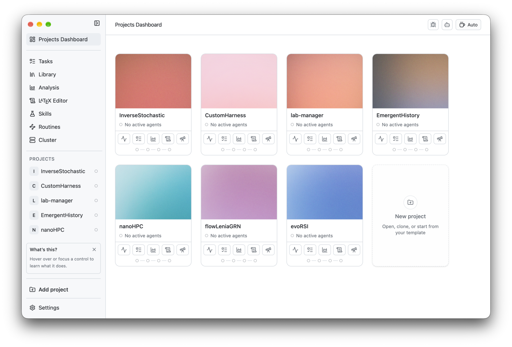

<h3 align="center">
  <br>
  PI lab
</h3>

<p align="center">
  
    <a href="https://github.com/enajx/PI-Lab/releases"></a>
  <a href="LICENSE"></a>
</p>

<p align="center">
  <a href="https://github.com/enajx/PI-Lab/releases">Download for macOS</a>
</p>

<p align="center">
  <picture>
    <source media="(prefers-color-scheme: dark)" srcset="docs/screenshots/dark-dracula.png">
    
  </picture>
</p>

PI lab is a workspace and editor designed for computational science and research. Besides running agents in parallel, it provides Zotero integration, a LaTeX editor, and built-in data visualization. See below for the full feature list.

Design philosophy: open-source, no lock-in, and no proprietary formats. Everything that can be markdown, should be markdown. 

##   Features

- Project-centric dashboard.
- Agents parallelization via git worktrees. 
- Visualization tool supporting media and data formats natively.
- Built-in LaTeX editor with Overleaf support.
- Markdown editor.
- Integrated Library with Zotero support.
- Single agent and worktree support for parallel agents.
- Skills and routines.
- Local dictation using whisper.cpp
- Markdown-based task tracking with GitHub issues integration.
- Caffeinated mode.
- Interface in [English](README.md), [Español](docs/readme-int/README.es.md), [Norsk](docs/readme-int/README.nb.md), [简体中文](docs/readme-int/README.zh-CN.md), [한국어](docs/readme-int/README.ko.md), [日本語](docs/readme-int/README.ja.md) and [العربية](docs/readme-int/README.ar.md).

## How to Install

A. Download the latest `.dmg` from [releases](https://github.com/enajx/PI-Lab/releases).

B. Build from source: `bun install` & `bun run dev` 

## Contributing

Issues and pull requests are welcome. Open an issue first for larger changes.

```sh
git clone git@github.com:enajx/PI-Lab.git
cd PI-Lab
bun install
git checkout -b my-change    # one branch per change
bun run dev                  # run the app from source
bun run lint                 # check before opening a pull request
bun run test
```

Then open a pull request into `main`.

## License

PI lab is free and open source under [MIT](LICENSE) licence.
