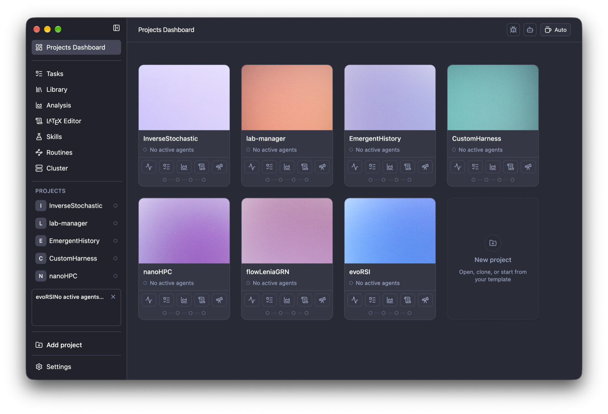

<p align="center">
  
</p>

<h1 align="center">PI Lab</h1>

<p align="center">An open-source workspace for computational research.</p>

<p align="center">
  <sub><b>English</b> · <a href="docs/readme-int/README.es.md">Español</a> · <a href="docs/readme-int/README.nb.md">Norsk</a> · <a href="docs/readme-int/README.zh-CN.md">简体中文</a> · <a href="docs/readme-int/README.ko.md">한국어</a> · <a href="docs/readme-int/README.ja.md">日本語</a> · <a href="docs/readme-int/README.ar.md">العربية</a></sub>
</p>

<p align="center">
  <sub>
    <a href="https://github.com/enajx/PI-Lab/releases"></a>
  <a href="LICENSE"></a></sub>
</p>

<p align="center">
  <a href="https://github.com/enajx/PI-Lab/releases">Download for macOS</a> · <a href="https://github.com/enajx/PI-Lab/releases">Releases</a> · <a href="LICENSE">License</a>
</p>

<p align="center">
  
</p>

PI Lab is a workspace and editor for working with coding agents designed specifically for computational science and research projects. Design philosophy: open-source and no proprietary formats: everything that can be markdown, should be markdown.

## Features

- Project-centric dashboard.
- Integrated Library with Zotero support.
- Single agent and worktree support for parallel agents.
- Built-in LaTeX editor with Overleaf support.
- Analysis view to visualise experiments.
- Skills and routines.
- Dictation based on whisper.cpp running purely locally.
- Markdown-based task tracking.
- Caffeinated mode.
- Interface in [English](README.md), [Español](docs/readme-int/README.es.md), [Norsk](docs/readme-int/README.nb.md), [简体中文](docs/readme-int/README.zh-CN.md), [한국어](docs/readme-int/README.ko.md), [日本語](docs/readme-int/README.ja.md) and [العربية](docs/readme-int/README.ar.md).

## Install

A. Download the latest `.dmg` from [releases](https://github.com/enajx/PI-Lab/releases).

B. Build from source: `bun install` & `bun run dev` 

## Contributing

Issues and pull requests are welcome. Open an issue first for larger changes.

```sh
git clone git@github.com:enajx/PI-Lab.git
cd PI-Lab
bun install
git checkout -b my-change    # one branch per change
bun run dev                  # run the app from source
bun run lint                 # check before opening a pull request
bun run test
```

Then open a pull request into `main`.

## License

PI Lab is free and open source under [MIT](LICENSE) licence.
