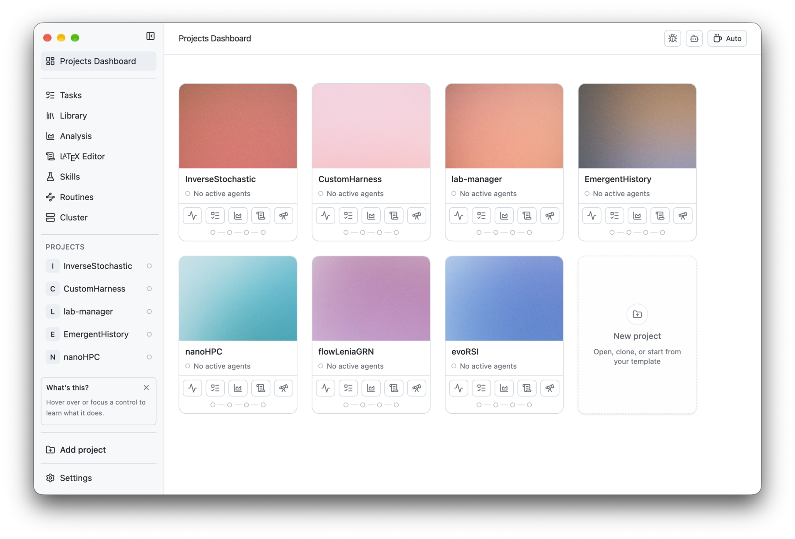

<h2 align="center">
  <br>
  PI lab
</h2>

<p align="center">مساحة عمل مفتوحة المصدر للبحث الحاسوبي.</p>

<p align="center">
  <sub><a href="../../README.md">English</a> · <a href="README.es.md">Español</a> · <a href="README.nb.md">Norsk</a> · <a href="README.zh-CN.md">简体中文</a> · <a href="README.ko.md">한국어</a> · <a href="README.ja.md">日本語</a> · <b>العربية</b></sub>
</p>

<p align="center">
  
    <a href="https://github.com/enajx/PI-Lab/releases"></a>
  <a href="../../LICENSE"></a>
</p>

<p align="center">
  <a href="https://github.com/enajx/PI-Lab/releases">تنزيل لنظام macOS</a> · <a href="https://github.com/enajx/PI-Lab/releases">الإصدارات</a> · <a href="../../LICENSE">الرخصة</a>
</p>

<p align="center">
  <picture>
    <source media="(prefers-color-scheme: dark)" srcset="../screenshots/dark-dracula.png">
    
  </picture>
</p>

<div dir="rtl">

PI lab هو مساحة عمل ومحرر للعمل مع وكلاء البرمجة، مصمم خصيصًا لمشاريع العلوم الحاسوبية والبحث. فلسفة التصميم: مفتوح المصدر وبلا صيغ مملوكة: كل ما يمكن أن يكون Markdown ينبغي أن يكون Markdown.

## الميزات

- لوحة تحكم تتمحور حول المشاريع.
- مكتبة مدمجة مع دعم Zotero.
- وكيل واحد، ودعم worktree لتشغيل وكلاء متوازيين.
- محرر LaTeX مدمج مع دعم Overleaf.
- عرض التحليل لتصوير التجارب بصريًا.
- المهارات والروتينات.
- الإملاء الصوتي المعتمد على whisper.cpp ويعمل محليًا بالكامل.
- تتبع المهام المعتمد على Markdown.
- وضع Caffeinated.
- الواجهة متوفرة بلغات: [English](../../README.md), [Español](README.es.md), [Norsk](README.nb.md), [简体中文](README.zh-CN.md), [한국어](README.ko.md), [日本語](README.ja.md) و[العربية](README.ar.md).

## التثبيت

أ. نزّل أحدث ملف `.dmg` من [الإصدارات](https://github.com/enajx/PI-Lab/releases).

ب. البناء من المصدر: `bun install` ثم `bun run dev` 

## المساهمة

نرحب بالمشكلات (issues) وطلبات السحب (pull requests). افتح issue أولًا للتغييرات الكبيرة.

```sh
git clone git@github.com:enajx/PI-Lab.git
cd PI-Lab
bun install
git checkout -b my-change    # فرع واحد لكل تغيير
bun run dev                  # تشغيل التطبيق من المصدر
bun run lint                 # افحص قبل فتح طلب السحب
bun run test
```

ثم افتح طلب سحب إلى `main`.

## الرخصة

PI lab حر ومفتوح المصدر بموجب رخصة [MIT](../../LICENSE).

</div>
