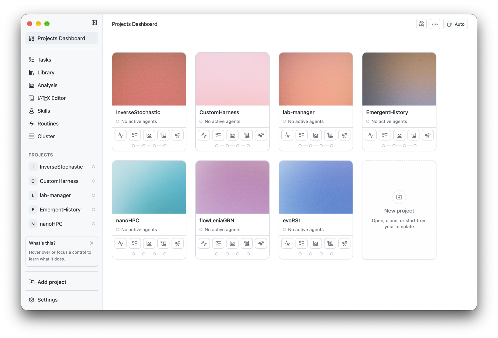

<h2 align="center">
  <br>
  PI lab
</h2>

<p align="center">Un espacio de trabajo de código abierto para la investigación computacional.</p>

<p align="center">
  <sub><a href="../../README.md">English</a> · <b>Español</b> · <a href="README.nb.md">Norsk</a> · <a href="README.zh-CN.md">简体中文</a> · <a href="README.ko.md">한국어</a> · <a href="README.ja.md">日本語</a> · <a href="README.ar.md">العربية</a></sub>
</p>

<p align="center">
  
    <a href="https://github.com/enajx/PI-Lab/releases"></a>
  <a href="../../LICENSE"></a>
</p>

<p align="center">
  <a href="https://github.com/enajx/PI-Lab/releases">Descargar para macOS</a> · <a href="https://github.com/enajx/PI-Lab/releases">Versiones</a> · <a href="../../LICENSE">Licencia</a>
</p>

<p align="center">
  <picture>
    <source media="(prefers-color-scheme: dark)" srcset="../screenshots/dark-dracula.png">
    
  </picture>
</p>

PI lab es un espacio de trabajo y editor para trabajar con agentes de programación, diseñado específicamente para proyectos de ciencia e investigación computacional. Filosofía de diseño: código abierto y sin formatos propietarios: todo lo que pueda ser markdown, debe ser markdown.

## Características

- Panel centrado en proyectos.
- Biblioteca integrada con soporte para Zotero.
- Un solo agente y soporte de worktrees para agentes en paralelo.
- Editor de LaTeX integrado con soporte para Overleaf.
- Vista de análisis para visualizar experimentos.
- Skills y rutinas.
- Dictado basado en whisper.cpp, que se ejecuta íntegramente en local.
- Seguimiento de tareas basado en Markdown.
- Modo cafeinado.
- Interfaz en [English](../../README.md), [Español](README.es.md), [Norsk](README.nb.md), [简体中文](README.zh-CN.md), [한국어](README.ko.md), [日本語](README.ja.md) y [العربية](README.ar.md).

## Instalación

A. Descarga el último `.dmg` desde [versiones](https://github.com/enajx/PI-Lab/releases).

B. Compila desde el código fuente: `bun install` & `bun run dev` 

## Contribuir

Las issues y los pull requests son bienvenidos. Abre primero una issue para cambios grandes.

```sh
git clone git@github.com:enajx/PI-Lab.git
cd PI-Lab
bun install
git checkout -b my-change    # una rama por cambio
bun run dev                  # ejecuta la app desde el código fuente
bun run lint                 # revisa antes de abrir un pull request
bun run test
```

Después abre un pull request hacia `main`.

## Licencia

PI lab es libre y de código abierto bajo licencia [MIT](../../LICENSE).
