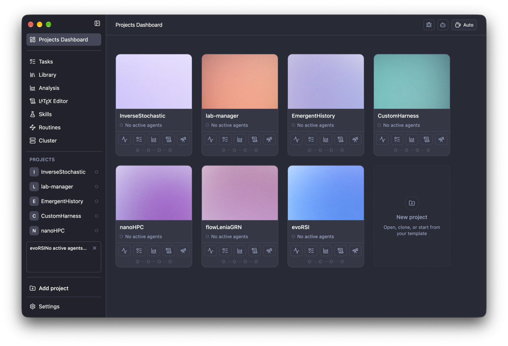

<p align="center">
  
</p>

<h1 align="center">PI Lab</h1>

<p align="center">計算研究のためのオープンソースのワークスペース。</p>

<p align="center">
  <sub><a href="../../README.md">English</a> · <a href="README.es.md">Español</a> · <a href="README.nb.md">Norsk</a> · <a href="README.zh-CN.md">简体中文</a> · <a href="README.ko.md">한국어</a> · <b>日本語</b> · <a href="README.ar.md">العربية</a></sub>
</p>

<p align="center">
  
    <a href="https://github.com/enajx/PI-Lab/releases"></a>
  <a href="../../LICENSE"></a>
</p>

<p align="center">
  <a href="https://github.com/enajx/PI-Lab/releases">macOS 版をダウンロード</a> · <a href="https://github.com/enajx/PI-Lab/releases">リリース</a> · <a href="../../LICENSE">ライセンス</a>
</p>

<p align="center">
  
</p>

PI Lab は、コーディングエージェントと作業するためのワークスペース兼エディタで、計算科学や研究プロジェクト向けに設計されています。設計方針は、オープンソースで独自形式を使わないこと。Markdown にできるものは、すべて Markdown にします。

## 機能

- プロジェクト中心のダッシュボード。
- Zotero に対応した統合ライブラリ。
- 単一のエージェントと、並列エージェント用の worktree のサポート。
- Overleaf に対応した組み込みの LaTeX エディタ。
- 実験を可視化する分析ビュー。
- スキルとルーティン。
- whisper.cpp をベースにした、完全にローカルで動作する音声入力。
- Markdown ベースのタスク管理。
- カフェインモード。
- [英語](../../README.md)、[Español](README.es.md)、[Norsk](README.nb.md)、[简体中文](README.zh-CN.md)、[한국어](README.ko.md)、[日本語](README.ja.md)、[العربية](README.ar.md) のインターフェース。

## インストール

A. [リリース](https://github.com/enajx/PI-Lab/releases)から最新の `.dmg` をダウンロードします。

B. ソースからビルド: `bun install` & `bun run dev` 

## コントリビューション

Issue とプルリクエストを歓迎します。大きな変更は、先に Issue を作成してください。

```sh
git clone git@github.com:enajx/PI-Lab.git
cd PI-Lab
bun install
git checkout -b my-change    # 変更ごとに 1 ブランチ
bun run dev                  # ソースからアプリを実行
bun run lint                 # プルリクエストを開く前に確認
bun run test
```

その後、`main` へのプルリクエストを作成してください。

## ライセンス

PI Lab は [MIT](../../LICENSE) ライセンスの無償のオープンソースです。
