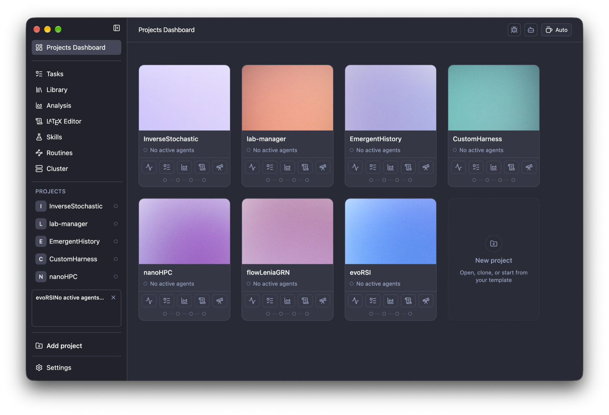

<p align="center">
  
</p>

<h1 align="center">PI Lab</h1>

<p align="center">전산 연구를 위한 오픈소스 워크스페이스.</p>

<p align="center">
  <sub><a href="../../README.md">English</a> · <a href="README.es.md">Español</a> · <a href="README.nb.md">Norsk</a> · <a href="README.zh-CN.md">简体中文</a> · <b>한국어</b> · <a href="README.ja.md">日本語</a> · <a href="README.ar.md">العربية</a></sub>
</p>

<p align="center">
  
    <a href="https://github.com/enajx/PI-Lab/releases"></a>
  <a href="../../LICENSE"></a>
</p>

<p align="center">
  <a href="https://github.com/enajx/PI-Lab/releases">macOS용 다운로드</a> · <a href="https://github.com/enajx/PI-Lab/releases">릴리스</a> · <a href="../../LICENSE">라이선스</a>
</p>

<p align="center">
  
</p>

PI Lab은 코딩 에이전트와 함께 작업하기 위한 워크스페이스이자 편집기로, 전산 과학 및 연구 프로젝트를 위해 특별히 설계되었습니다. 설계 철학: 오픈소스이며 독점 형식을 쓰지 않습니다. Markdown으로 만들 수 있는 것은 모두 Markdown으로 만듭니다.

## 기능

- 프로젝트 중심 대시보드.
- Zotero를 지원하는 통합 라이브러리.
- 단일 에이전트 및 병렬 에이전트를 위한 worktree 지원.
- Overleaf를 지원하는 내장 LaTeX 편집기.
- 실험을 시각화하는 분석 뷰.
- 스킬과 루틴.
- 완전히 로컬에서 실행되는 whisper.cpp 기반 음성 받아쓰기.
- Markdown 기반 작업 추적.
- 카페인 모드.
- 인터페이스 언어: [English](../../README.md), [Español](README.es.md), [Norsk](README.nb.md), [简体中文](README.zh-CN.md), [한국어](README.ko.md), [日本語](README.ja.md), [العربية](README.ar.md).

## 설치

A. [릴리스](https://github.com/enajx/PI-Lab/releases)에서 최신 `.dmg`를 다운로드합니다.

B. 소스에서 빌드: `bun install` & `bun run dev` 

## 기여하기

이슈와 풀 리퀘스트를 환영합니다. 큰 변경은 먼저 이슈를 열어 주세요.

```sh
git clone git@github.com:enajx/PI-Lab.git
cd PI-Lab
bun install
git checkout -b my-change    # 변경마다 브랜치 하나
bun run dev                  # 소스에서 앱 실행
bun run lint                 # 풀 리퀘스트를 열기 전에 확인
bun run test
```

그런 다음 `main`으로 풀 리퀘스트를 여세요.

## 라이선스

PI Lab은 [MIT](../../LICENSE) 라이선스의 무료 오픈소스입니다.
