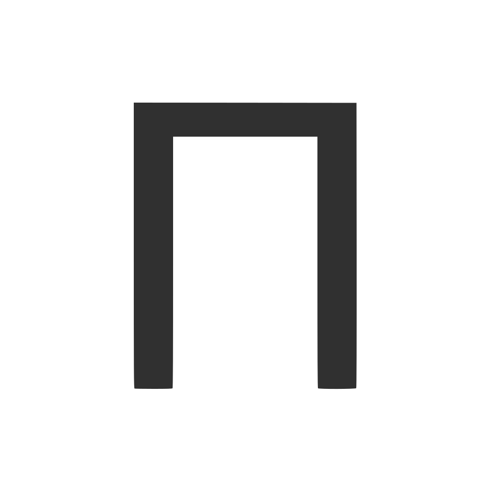
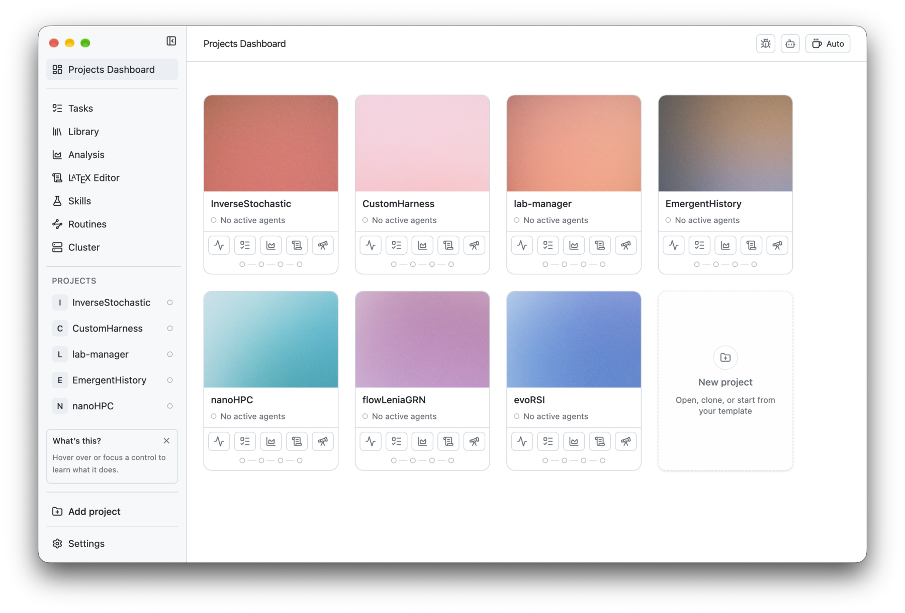

<h2 align="center">
  <br>
  PI lab
</h2>

<p align="center">Et åpen kildekode-arbeidsområde for beregningsbasert forskning.</p>

<p align="center">
  <sub><a href="../../README.md">English</a> · <a href="README.es.md">Español</a> · <b>Norsk</b> · <a href="README.zh-CN.md">简体中文</a> · <a href="README.ko.md">한국어</a> · <a href="README.ja.md">日本語</a> · <a href="README.ar.md">العربية</a></sub>
</p>

<p align="center">
  
    <a href="https://github.com/enajx/PI-Lab/releases"></a>
  <a href="../../LICENSE"></a>
</p>

<p align="center">
  <a href="https://github.com/enajx/PI-Lab/releases">Last ned for macOS</a> · <a href="https://github.com/enajx/PI-Lab/releases">Utgivelser</a> · <a href="../../LICENSE">Lisens</a>
</p>

<p align="center">
  <picture>
    <source media="(prefers-color-scheme: dark)" srcset="../screenshots/dark-dracula.png">
    
  </picture>
</p>

PI lab er et arbeidsområde og en editor for arbeid med kodeagenter, laget spesielt for prosjekter innen beregningsvitenskap og forskning. Designfilosofi: åpen kildekode og ingen proprietære formater: alt som kan være Markdown, bør være Markdown.

## Funksjoner

- Prosjektsentrert dashbord.
- Integrert bibliotek med støtte for Zotero.
- Én enkelt agent, og støtte for worktrees for parallelle agenter.
- Innebygd LaTeX-editor med støtte for Overleaf.
- Analysevisning for å visualisere eksperimenter.
- Ferdigheter (skills) og rutiner.
- Diktering basert på whisper.cpp, som kjører helt lokalt.
- Oppgavesporing basert på Markdown.
- Koffeinmodus.
- Grensesnitt på [English](../../README.md), [Español](README.es.md), [Norsk](README.nb.md), [简体中文](README.zh-CN.md), [한국어](README.ko.md), [日本語](README.ja.md) og [العربية](README.ar.md).

## Installasjon

A. Last ned den nyeste `.dmg`-filen fra [utgivelser](https://github.com/enajx/PI-Lab/releases).

B. Bygg fra kildekode: `bun install` & `bun run dev` 

## Bidra

Issues og pull requests er velkomne. Åpne en issue først for større endringer.

```sh
git clone git@github.com:enajx/PI-Lab.git
cd PI-Lab
bun install
git checkout -b my-change    # én gren per endring
bun run dev                  # kjør appen fra kildekode
bun run lint                 # sjekk før du åpner en pull request
bun run test
```

Åpne deretter en pull request mot `main`.

## Lisens

PI lab er gratis og åpen kildekode under [MIT](../../LICENSE)-lisensen.
