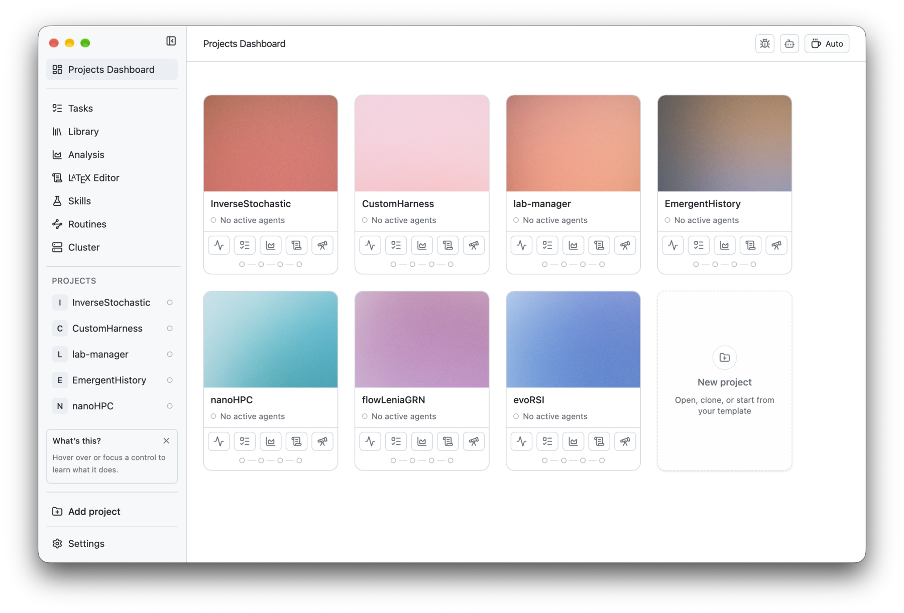

<h2 align="center">
  <br>
  PI lab
</h2>

<p align="center">面向计算研究的开源工作区。</p>

<p align="center">
  <sub><a href="../../README.md">English</a> · <a href="README.es.md">Español</a> · <a href="README.nb.md">Norsk</a> · <b>简体中文</b> · <a href="README.ko.md">한국어</a> · <a href="README.ja.md">日本語</a> · <a href="README.ar.md">العربية</a></sub>
</p>

<p align="center">
  
    <a href="https://github.com/enajx/PI-Lab/releases"></a>
  <a href="../../LICENSE"></a>
</p>

<p align="center">
  <a href="https://github.com/enajx/PI-Lab/releases">下载 macOS 版</a> · <a href="https://github.com/enajx/PI-Lab/releases">发布版本</a> · <a href="../../LICENSE">许可证</a>
</p>

<p align="center">
  <picture>
    <source media="(prefers-color-scheme: dark)" srcset="../screenshots/dark-dracula.png">
    
  </picture>
</p>

PI lab 是一个与编程智能体协同工作的工作区和编辑器，专为计算科学和研究项目设计。设计理念：开源，不使用专有格式：凡是能用 Markdown 的，都用 Markdown。

## 功能

- 以项目为中心的仪表盘。
- 集成文献库，支持 Zotero。
- 支持单个智能体，以及用于并行智能体的 worktree。
- 内置 LaTeX 编辑器，支持 Overleaf。
- 分析视图，用于可视化实验。
- 技能和例行任务。
- 基于 whisper.cpp 的听写，完全在本地运行。
- 基于 Markdown 的任务跟踪。
- 防休眠模式。
- 界面语言：[English](../../README.md)、[Español](README.es.md)、[Norsk](README.nb.md)、[简体中文](README.zh-CN.md)、[한국어](README.ko.md)、[日本語](README.ja.md) 和 [العربية](README.ar.md)。

## 安装

A. 从[发布页面](https://github.com/enajx/PI-Lab/releases)下载最新的 `.dmg`。

B. 从源码构建：`bun install` & `bun run dev` 

## 参与贡献

欢迎提交 Issue 和 Pull Request。较大的改动请先开一个 Issue。

```sh
git clone git@github.com:enajx/PI-Lab.git
cd PI-Lab
bun install
git checkout -b my-change    # 每个改动一个分支
bun run dev                  # 从源码运行应用
bun run lint                 # 提交 Pull Request 前检查
bun run test
```

然后向 `main` 提交 Pull Request。

## 许可证

PI lab 以 [MIT](../../LICENSE) 许可证开源，可免费使用。
